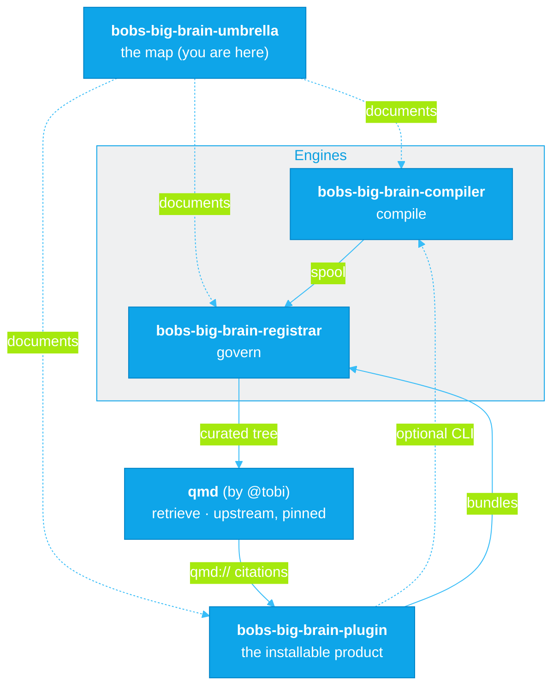
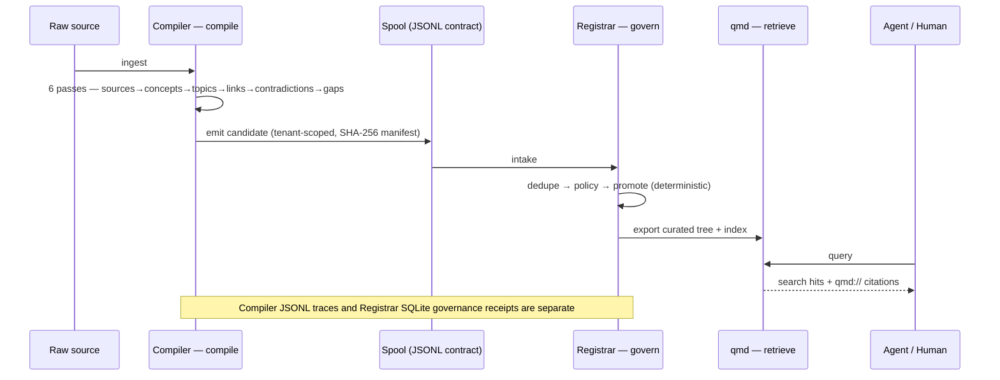
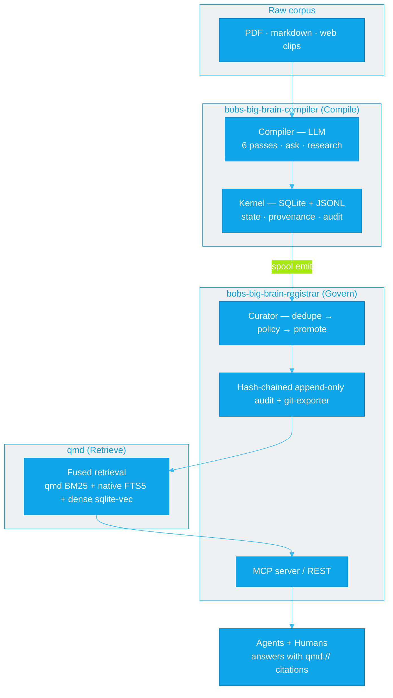

<p align="center">
  <picture>
    <source media="(prefers-color-scheme: dark)" srcset="assets/banner-dark.svg">
    
  </picture>
</p>

<h1 align="center">Bob's Big Brain</h1>

<p align="center">
  <strong>The governed team brain — cited recall, hash-chained receipts.</strong><br>
  Turn <em>your own</em> files into a governed, <code>qmd://</code>-cited team brain with a tamper-evident audit trail — for humans and agents.<br>
  <strong>Compile, then govern.</strong> Local by default; remote sharing is your opt-in.
</p>

<p align="center">
  <a href="https://github.com/jeremylongshore/bobs-big-brain-compiler/actions/workflows/ci.yml"></a>
  <a href="https://github.com/jeremylongshore/bobs-big-brain-registrar/actions/workflows/ci.yml"></a>
  <a href="https://www.npmjs.com/package/intentional-cognition-os"></a>
<a href="https://ko-fi.com/U5S225PTME"></a>
  
  
</p>

<p align="center">
  <strong>▸ Get the plugin:</strong>
  <a href="https://github.com/jeremylongshore/bobs-big-brain-plugin"><strong>bobs-big-brain-plugin</strong></a>
  &nbsp;&nbsp;·&nbsp;&nbsp;
  <strong>Engines:</strong>
  <a href="https://github.com/jeremylongshore/bobs-big-brain-compiler">bobs-big-brain-compiler</a> ·
  <a href="https://github.com/jeremylongshore/bobs-big-brain-registrar">bobs-big-brain-registrar</a>
</p>

---

This repo is the umbrella for the **Bob's Big Brain** stack — local-first knowledge built on the *compile, then govern* architecture. Each component is its own independently developed and released repository; this repo is where we explain **what they are, what they do, how they stack, and why they beat the alternatives.** No application code lives here — just the map.

## The 60-second version

Most "AI memory" gives an agent better **recall**. This stack does two things the category skips: it **compiles** raw corpus into derived knowledge (summaries, concepts, contradictions — not raw chunks), and it **governs** that knowledge through a deterministic pipeline before anything is trusted. Search returns `qmd://` source citations. Durable governance settlements write SHA-256 hash-chained receipts; a citation or search result is not itself a governance receipt. Runs on your machine. No vector-blob lock-in.

## The problem

AI agents are getting better memory by the week. Recall alone does not answer the question that matters when something breaks: **what did the agent actually do with what it remembered, and can you prove it?**

A better memory makes an agent *recall* more. It says nothing about whether that knowledge was ever vetted, where it came from, or what the agent used at decision time. **Memory is not accountability.** Recall is table stakes. The hard problem — the one a compliance officer, an on-call engineer, or a postmortem actually needs — is the **receipt**: what was retrieved, what was used, where it came from, provable later, tamper-evident.

This stack is built around that gap.

## How we're different

The category optimizes one axis: recall. We compete on a different one: **govern + receipts.**

| Capability | Mechanism | Boundary |
|---|---|---|
| Derived knowledge | Optional Compiler CLI with six passes | Compilation uses the configured provider; it is separate from the plugin govern path. |
| Deterministic governance | Dedupe, policy and durable settlement | Pre-intake refusals and review-only flags have different receipt behavior. |
| Cited retrieval | Search hits carry `qmd://` source URIs | A citation does not prove an answer used the fact or is correct. |
| Tamper-evident history | Hash-chained governance events and retained anchors | A local writer can rewrite the store and all local witnesses. |
| Local and team modes | In-process local server or authenticated remote proxy | Team mode is code-checked; released and deployed acceptance are separate evidence. |

These are implementation boundaries, not a current competitor benchmark. The linked
[ecosystem thesis](#documentation) records the historical comparison. Recall alone
does not establish how knowledge was governed or what a model actually used.


## What's in the stack

| Repo | Layer | What it does |
|------|-------|--------------|
| **[bobs-big-brain-compiler](https://github.com/jeremylongshore/bobs-big-brain-compiler)** | **Compile** | Reads and organizes raw sources (npm: `intentional-cognition-os`). Ingests raw corpus (PDF / markdown / web clips) and compiles it into semantic knowledge through six passes, runs episodic research tasks, and emits a governance spool. Deterministic kernel (SQLite + JSONL) + probabilistic compiler (LLM). 5 workspace packages, Apache-2.0. |
| **[bobs-big-brain-registrar](https://github.com/jeremylongshore/bobs-big-brain-registrar)** | **Govern** | Decides what's admitted to team memory (by code) and keeps the tamper-evident record. Consumes the Compiler's spool, runs every candidate through dedupe → policy → promotion, keeps a hash-chained, by-protocol append-only audit log, and exports curated memory to a searchable tree. The deterministic control plane. 6 apps + 10 packages, Apache-2.0. |
| **[qmd](https://github.com/tobi/qmd)** (`@tobilu/qmd`) | **Retrieve** | On-device search for markdown, by [@tobi](https://github.com/tobi). qmd supplies the lexical BM25 arm; Govern fuses it with native FTS5 and a lean sqlite-vec/EmbeddingGemma dense arm through RRF (k=60), then freshness/category reranks. No query-time generative LLM call. Every hit is a `qmd://<collection>/<path>` URI — the citation. |
| **[bobs-big-brain-plugin](https://github.com/jeremylongshore/bobs-big-brain-plugin)** | **Package** | The thing you install. A local-first Claude Code + Cowork plugin that **bundles the Registrar libraries** into one stdio MCP server. Local mode governs and searches in-process; team mode proxies to a server. The Compiler CLI is optional and separate. Native setup needs registry access; semantic retrieval needs a separately provisioned local embedder. |

**Powered by [tobi/qmd](https://github.com/tobi/qmd).** We pin `@tobilu/qmd`, track bumps with Dependabot, and gate upgrades with canary + integration tests. We **do not fork** the search engine — Bob's Big Brain is the product surround (compile + govern + receipts + plugin).

**Operator tip (local team brain):** bare `qmd` uses your personal `~/.cache/qmd`. The team index lives under `~/.teamkb/qmd-index/<tenant>/`. From a [bobs-big-brain-registrar](https://github.com/jeremylongshore/bobs-big-brain-registrar) checkout: `./scripts/bbb-qmd status` (pinned `@tobilu/qmd` binary + team XDG) and `pnpm search-canary`. Full runbook: [000-docs/042-OD-OPSM-bbb-qmd-operator-runbook.md](https://github.com/jeremylongshore/bobs-big-brain-registrar/blob/main/000-docs/042-OD-OPSM-bbb-qmd-operator-runbook.md).

**How the repos fit together** — this umbrella maps them; the plugin bundles governance libraries and can invoke the optional Compiler CLI; the engines + qmd form the compile → govern → retrieve pipeline. Each box is its own independently released repo:



## How it works

A source proposal can become governed memory and then a cited search result:



**The five steps:** ingest → **compile** (derive, don't dump) → spool (the tenant-scoped JSONL contract between repos) → **govern** (dedupe/policy/promote, by code) → **retrieve** (cited, on-device). The Compiler records its own hash-chained JSONL traces. The Registrar separately records governance settlements in SQLite `audit_events`; their verifiers and scopes differ.

## Architecture



**The constraint that makes it work:** *the model proposes; the deterministic system owns durable state and control.* Compilation, synthesis, and contradiction-detection are probabilistic and live in the compiler. File storage, governance, permissions, audit, and promotion rules are deterministic and live in the kernel. Models propose derived content; deterministic code performs the durable writes and policy transitions. That boundary is the whole design — it's what lets a probabilistic system produce an auditable record.

## The two flagships, up close

### The Compiler — reads and organizes

[`bobs-big-brain-compiler`](https://github.com/jeremylongshore/bobs-big-brain-compiler) (npm: `intentional-cognition-os`) is a local-first knowledge OS with a CLI (`ico`). It **derives** rather than indexes: across six passes it computes source summaries, concepts, topic pages, backlinks, contradictions, and gaps from your corpus — and keeps raw and derived strictly separate, with provenance from the first byte. Hard questions get an episodic research workspace (a five-agent collector→summarizer→skeptic→integrator→orchestrator flow) that's archived when done. When knowledge is ready to leave the building, the Compiler **emits a spool**: the tenant-scoped JSONL contract the Registrar consumes.

### The Registrar — the governance layer

[`bobs-big-brain-registrar`](https://github.com/jeremylongshore/bobs-big-brain-registrar) is the deterministic control plane for team memory. It ingests the Compiler's spool and runs every candidate through **dedupe → policy → promotion** — secret detection, trust levels, and tenant isolation all live here, enforced by code, not by a model. Durable promotions and rejections are written to a **hash-chained, by-protocol append-only audit log**; curated memory is exported to a category-routed markdown tree and indexed by qmd. An MCP server exposes governed, curated-only search to agents.

### qmd — the retrieval substrate

[`qmd`](https://github.com/tobi/qmd) (by [@tobi](https://github.com/tobi)) is on-device search for markdown, no API key required. We pin it, track it with Dependabot, and gate every version bump through integration tests. In the delivered serving path, qmd supplies one lexical BM25 arm; Govern adds native in-process FTS5 plus a lean sqlite-vec/EmbeddingGemma-300M dense arm and fuses all three with reciprocal-rank fusion (RRF, k=60), then applies freshness/category reranking. Dense fails open to the lexical arms if its embedder is unavailable, and no query-time generative LLM is involved. Every result is a `qmd://<collection>/<path>` URI — which is exactly the citation an answer needs.

## Citations, traces and governance receipts

These artifacts record different parts of the pipeline. They do not prove that a model used a retrieved fact or that its answer is correct.

**1. The spool candidate** — the Compiler's hand-off contract. Tenant-scoped, schema-versioned and content-capped, with a SHA-256 manifest. Illustrative fragment; content, author and trust fields are omitted:

```json
{
  "schemaVersion": "1",
  "id": "c639f0ca-47a8-51df-af06-736f03cbffc4",
  "status": "inbox",
  "source": "import",
  "title": "Transformer attention mechanism",
  "category": "architecture",
  "tenantId": "acme-team",
  "metadata": { "filePaths": ["wiki/topics/transformers.md"], "tags": ["transformer"] },
  "prePolicyFlags": { "potentialSecret": false, "lowConfidence": false, "duplicateSuspect": false },
  "capturedAt": "2026-06-01T00:00:00.000Z"
}
```

**2. The Compiler trace** — `ico ask` writes an `ask` event to the Compiler's hash-chained JSONL trace. These are citation **counts**, not arrays of source URIs. This illustrative fragment omits other envelope and payload fields and abbreviates its hash:

```jsonc
{ "event_type": "ask", "correlation_id": "…",
  "payload": { "verifiedCitations": 1, "unverifiedCitations": 0 },
  "prev_hash": "9f2c…" }
```

The separate JSON answer contains citation details. Registrar governance receipts instead live in SQLite `audit_events`; HTTP search access logs are not that chain. Pre-intake disclosure refusals do not create a candidate or governance receipt. Review-only flags can remain without a new receipt.

**3. The Compiler verifier** — walks that JSONL chain, not the Registrar database. Illustrative output:

```console
$ ico audit verify --json
{ "ok": true, "filesScanned": 1, "totalEvents": 61, "cleanFiles": 1, "breaks": [] }
```

Use `ico audit verify` for Compiler traces and local `brain_audit_verify` for Registrar governance receipts and anchors. Passing one does not prove the other passed. Neither establishes what a model actually used. A writer who edits and re-hashes forward can evade a chain-only check; retained independent anchors matter.

### What the receipt does *not* do — read this before you trust it

Honesty is the whole point of a receipt, so here's the trust model, stated per mode:

| Surface | Evidence and limits |
|---|---|
| Local governance chain | Integrity and ordering checks over stored events. A writer able to edit and re-hash the whole chain can defeat a chain-only check. |
| Local anchor log and git witness | The plugin attempts to commit chain-head snapshots. Retained prior snapshots can reveal rewrites; anchor or git failure can leave a write without a fresh witness. Local commit success does not prove a remote push or independent witness. |
| Shared service | The team plugin is an authenticated proxy; it does not expose local `brain_audit_verify`. A remote service or pushed anchor alone does not prove per-actor attribution or non-repudiation. |

The trail is **tamper-evident, not tamper-proof**. Someone able to rewrite the store, anchor log and witness can evade those local checks. No immutable-storage or blockchain claim is made. Signed merge anchors have their own contract; they are not a universal identity guarantee for every local or remote write.

## Is it real? — the proof

Not a claim — a trail:

- **Dated end-to-end evidence.** The committed [2026-06-14 demo summary](https://github.com/jeremylongshore/bobs-big-brain-compiler/blob/9dc7488/dogfood/runs/demo-2026-06-14T031420Z/summary.json) records seven passing stages. It is historical evidence, not a fresh run or deployed acceptance. Counts from older runs are not current product metrics.
- **Continuously guarded.** A key-free nightly CI smoke replays the deterministic half (govern → retrieve → cite) off a frozen fixture — any regression in the chain trips a red build, with no API calls and no secrets.
- **Public dog-food trail.** The Compiler eats its own cooking against real corpora and publishes the citation-verify-rate trend over time. The metrics are public; the source content stays private.

## Getting started

**Most people want the plugin** — local governance and cited search inside Claude Code or Cowork; compilation is optional:

→ **[jeremylongshore/bobs-big-brain-plugin](https://github.com/jeremylongshore/bobs-big-brain-plugin)** — one command: `npx governed-second-brain init <folder> --index-only` *(skips model compilation; npm/native setup may still access the registry)*

To run the deterministic fixture demo from source, use Node 22+, git and Corepack. Dependency installation needs registry access; the fixture path makes no model calls:

<!-- intent-select-partner:start -->
[](https://intentsolutions.io/)

Intent Solutions is a Claude Partner Network Select Services Partner.
<!-- intent-select-partner:end -->

```bash
corepack enable

# 1. clone both engines
git clone https://github.com/jeremylongshore/bobs-big-brain-compiler.git
git clone https://github.com/jeremylongshore/bobs-big-brain-registrar.git

# 2. build the Registrar (installs the pinned qmd binary)
cd bobs-big-brain-registrar && pnpm install --frozen-lockfile && pnpm build && cd ..

# 3. run the deterministic half of the chain off a fixture (govern → retrieve → cite)
cd bobs-big-brain-compiler
pnpm install --frozen-lockfile
pnpm build
scripts/demo-e2e.sh --intkb-repo ../bobs-big-brain-registrar \
  --from-spool dogfood/fixtures/smoke-spool
```

Full compilation uses the configured model provider and can send source content to it. Follow the Compiler's provider setup, and retain the explicit `--intkb-repo` path when running the full demo. The fixture command proves only the deterministic stages; it skips compilation and the Compiler audit stage.

## Release tags and source state

Latest GitHub release tags checked 2026-10-26. A matching manifest version does not identify the current bundle or installed payload; merged source can lead these tags. Release/distribution reconciliation remains tracked separately.

| Repo | Version | License |
|------|---------|---------|
| [bobs-big-brain-plugin](https://github.com/jeremylongshore/bobs-big-brain-plugin) (the installable product) | [v1.2.0](https://github.com/jeremylongshore/bobs-big-brain-plugin/releases/tag/v1.2.0) | Apache-2.0 |
| [bobs-big-brain-compiler](https://github.com/jeremylongshore/bobs-big-brain-compiler) (npm: `intentional-cognition-os`) | [v1.23.1](https://github.com/jeremylongshore/bobs-big-brain-compiler/releases/tag/v1.23.1) | Apache-2.0 |
| [bobs-big-brain-registrar](https://github.com/jeremylongshore/bobs-big-brain-registrar) | v0.8.0 | Apache-2.0 |
| [qmd](https://github.com/tobi/qmd) (upstream dependency) | 2.5.3 — pinned · Dependabot-tracked · integration-test-gated | MIT |

## Documentation

- **Ecosystem thesis** — *"Compile, Then Govern"*, peer-reviewed and Semantic-Scholar-grounded — has separately maintained copies in both flagships at `000-docs/034-AT-NTRP-ecosystem-thesis.md`.
- **Build-direction decision record** — `000-docs/035-AT-DECR-post-thesis-build-direction-2026-05-23.md` (both repos).
- Per-repo architecture, standards, and ADRs live in each repo's `000-docs/`.

## License

Apache-2.0 covers repository code in both flagships, the plugin and this umbrella. Semantic model weights have separate upstream terms. See each repo's `LICENSE`. (qmd, the upstream retrieval dependency, is MIT-licensed by its author, [@tobi](https://github.com/tobi).)

---

<p align="center">
  Intent Solutions — <a href="https://intentsolutions.io">intentsolutions.io</a>
</p>
